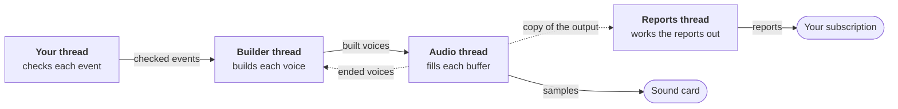

# How the engine is built

An engine takes events from your program and turns them into samples.
A live engine does this on threads of its own, so that the thread the sound card calls never waits for anything.
An offline engine has no thread of its own and does all of it inside the calls you make.
Both run the same mixer, so what an offline engine renders is what a live one plays at the same rate.

## A live engine



Each thread does one thing.

- **Your thread** calls [`Engine::play`], which checks every event of the batch against what its synth declares, hands the batch on and returns.
  A batch with a mistake plays nothing, and the error says which option of which synth was wrong.
- **The builder thread** builds each note's voice, which is the costly part of starting a note: it runs the synth's build function and allocates everything the voice needs.
  It builds the notes in the order they were handed over.
  It is also where the events given in beats wait, and it places each at its frame 150 ms before it sounds, as [the guide to time][time] describes.
- **The audio thread** is the one the sound card calls for each buffer.
  It starts each voice at its frame, applies each change at its own sample, runs the effects and adds everything up.
  It allocates nothing, frees nothing and waits for no lock.
  Voices reach it already built over one ring buffer, and the ones that have ended go back over another to be freed elsewhere.
- **The reports thread** works out what the engine says of itself: the levels and the spectrum of the output, the clock, the count of notes.
  It sleeps while nobody subscribes, and the audio thread only copies its output for it while levels are wanted.
  [The guide to reports][reports] lists what it sends.

A recording has one more thread, which writes the file.

## An offline engine

[`Engine::offline`] makes an engine that plays into memory, as fast as the machine allows.

- [`Engine::play`] builds each voice inside the call.
- [`Engine::render`] fills the next stretch inside the call and returns its samples.
- The reports are worked out as it renders.

An offline engine is repeatable.
The same events and the same calls give the same samples and the same reports on every run, and the samples are the same whatever the length of each stretch `render` is asked for.
A synth's noise is drawn from a seed, [`Context::seed`], which comes from the synth's name and not from the clock.

```rust
use mxs::{Engine, Event, RATE, synths};

fn render(stretch: f64) -> Result<Vec<f32>, mxs::Error> {
    let mut engine = Engine::offline(RATE);
    synths::all().into_iter().for_each(|s| engine.register(s));
    engine.play(&[(0.1, Event::note(None, "snare", &[]))])?;

    let mut left = Vec::new();
    while engine.now() < 1.0 {
        left.extend(engine.render(stretch)?.0);
    }
    Ok(left)
}

fn main() -> Result<(), mxs::Error> {
    assert_eq!(render(1.0)?, render(0.25)?);
    Ok(())
}
```

An offline engine takes events in only as it renders.
A piece of many thousands of events is therefore handed over a stretch at a time, between renders; otherwise `play` returns [`Error::Busy`].

## When something goes wrong

A fault in one synth does not take the process down.

| What happens | What the engine does |
| --- | --- |
| A synth's build function panics on the builder thread. | That note is left out, and [`Engine::warnings`] names the synth. |
| A synth or an effect panics while the audio thread runs it. | The engine plays silence from then on, and every later call returns [`Error::Failed`]. |
| The output device goes away. | Every later call returns [`Error::DeviceLost`] with the device's name. |
| Events are handed over faster than the audio thread takes them. | The call waits up to a second for room, then returns [`Error::Busy`]. |

After `Failed` or `DeviceLost`, make a new engine.

[time]: time.md
[reports]: reports.md
