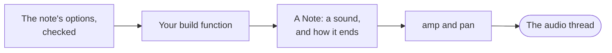

# A synth or an effect of your own

The synths that come with the crate are built only from what the crate makes public.
A synth of yours is written the same way and registered next to them, and so is an effect.

There are two ways to write one.
In Rust, a synth is a function that returns a [FunDSP](https://github.com/SamiPerttu/fundsp) unit.
As data, it is a [`graph::Graph`] built at run time, with no compiling.

## A synth in Rust

A synth is a name, the options it declares, and a function that builds one note's sound from the options the note was played with.

```rust
use fundsp::prelude::*;
use mxs::nodes::{db, hz, modes};
use mxs::{Engine, Event, Note, RATE, Spec, SynthDecl};

fn main() -> Result<(), mxs::Error> {
    let plate = SynthDecl::new("plate")
        .doc("A metal plate struck with a hard mallet.")
        .option(Spec::note("note").default(60.0).doc("The pitch."))
        .option(Spec::float("vel").default(0.6).range(0.0, 1.0).doc("How hard the plate is struck."))
        .build(|note, _ctx| {
            let freq = hz(note.number("note"));
            let strike = Net::wrap(Box::new(impulse::<U1>()));
            let struck = modes(strike, &[freq, freq * 2.76], &[1.0, db(-6.0)], &[3.0, 1.2]);
            Note::rings(struck * (0.2 * note.number("vel")) as f32, 4.0)
        });

    let mut engine = Engine::offline(RATE);
    engine.register(plate);
    engine.play(&[(0.0, Event::note(None, "plate", &[("vel", 0.9)]))])?;
    let (left, _right) = engine.render(1.0)?;
    assert!(left.iter().any(|sample| sample.abs() > 0.001));
    Ok(())
}
```

The build function runs once for each note, off the audio thread, and what it returns is run by the audio thread.



### Declaring options

Each option is a [`Spec`]: a name, a kind, and optionally a default, a range and a sentence of documentation.
The engine checks every note against them before the build function sees it, so the function reads its options without checking anything.

| Declared with | Takes |
| --- | --- |
| [`Spec::note`] | A MIDI note, fractions allowed. |
| [`Spec::hz`] | A frequency in hertz. |
| [`Spec::db`] | A level in decibels. |
| [`Spec::seconds`] | A time in seconds. |
| [`Spec::beats`] | A time given in beats in a pass, and in seconds to `play`. |
| [`Spec::float`] | Any number. |
| [`Spec::integer`] | A whole number. |
| [`Spec::boolean`] | 0 or 1. |
| [`Spec::name`] | One of a list of names. |

- [`Spec::default`] gives the value a note takes when it leaves the option out.
- [`Spec::range`] gives the lowest and the highest number. A value outside is held to the range, with a warning.
- [`Spec::required`] makes the option one every note must give.
- An option with neither a default nor `required` may be left out, and [`Options::given`] says whether it was.
- Every note also takes `amp` and `pan`, which the engine applies after the build function. A synth does not declare them.

### Reading options

The build function reads the note's [`Options`] in two ways.

- [`Options::number`] and [`Options::name`] give the value the note starts with.
- [`Options::follow`] gives a signal of the value, which glides to each new value an `Event::Set` gives while the note sounds.

An option read with `follow` is one a caller can change under a sounding note, with its `_slide` partner for the glide.
This synth follows its pitch and its filter:

```rust
use fundsp::prelude::*;
use mxs::{Engine, Event, Note, RATE, Spec, SynthDecl, Target};

fn main() -> Result<(), mxs::Error> {
    let lead = SynthDecl::new("lead")
        .option(Spec::note("note").default(57.0).doc("The pitch."))
        .option(Spec::hz("cutoff").default(1200.0).range(20.0, 20_000.0).doc("Where the low-pass cuts."))
        .options(Spec::envelope(1.0, 0.2))
        .build(|note, _ctx| {
            let pitch = note.follow("note") >> map(|n: &Frame<f32, U1>| midi_hz(n[0]));
            let sound = ((pitch >> saw()) | note.follow("cutoff") | dc(1.0)) >> lowpass::<f32>();
            Note::envelope(sound * 0.2, note)
        });

    let mut engine = Engine::offline(RATE);
    engine.register(lead);
    let held = Event::note(Some(1), "lead", &[("sustain", 2.0)]);
    let open = Event::Set {
        target: Target::Sounds(vec![1]),
        options: vec![("cutoff".to_string(), 6000.0), ("cutoff_slide".to_string(), 1.0)],
    };
    engine.play(&[(0.0, held), (0.5, open)])?;
    let (left, _right) = engine.render(2.0)?;
    assert!(left.iter().any(|sample| sample.abs() > 0.001));
    Ok(())
}
```

### How the note ends

The build function returns a [`Note`], which is the sound together with how it ends.
The engine needs that to free the voice at the right frame.

- [`Note::rings`] is a sound that fades by itself, and the seconds after which it is silent.
- [`Note::envelope`] shapes the sound by the note's envelope options, which the synth declares with [`Spec::envelope`], giving its own default `sustain` and `release`. Such a note falls silent over its `release` when it is let go.
- [`Note::within`] ends a note after a number of seconds if it would end later.

The sound has one channel or two.
A mono sound is placed by the note's `pan`, and a stereo one is balanced by it.

### Noise that repeats

[`Context::seed`] gives a seed for a random node.
It comes from the synth's name and from how many seeds the function asked for before, so a note sounds the same on every run.
[`nodes::white_noise`], [`nodes::pink_noise`] and [`nodes::dust`] take one.

### The nodes

The sound is a FunDSP unit, so FunDSP's own units and operators work.
The [`nodes`] module adds the ones the crate's synths are made of.

| For | Nodes |
| --- | --- |
| Things that ring when struck | [`nodes::mode`], [`nodes::struck`], [`nodes::modes`], a bank of resonators set ringing by its input |
| Levels that move in time | [`nodes::shape`], [`nodes::segments`], [`nodes::exp_segments`], [`nodes::gated`], [`nodes::hit`] |
| Tones | [`nodes::harmonic_tone`], harmonics whose levels move as the note sounds |
| Noise and chance | [`nodes::white_noise`], [`nodes::pink_noise`], [`nodes::dust`], [`nodes::Draws`] |
| Units | [`nodes::hz`], from a MIDI note, and [`nodes::db`], from decibels |

## An effect in Rust

An effect is declared the same way, with [`EffectDecl::new`](crate::EffectDecl::new).
Its build function returns a unit with two inputs and two outputs, the left and the right channel.

```rust
use fundsp::prelude::*;
use mxs::{EffectDecl, Engine, Event, RATE, Spec, Value, synths};

fn main() -> Result<(), mxs::Error> {
    let dull = EffectDecl::new("dull")
        .option(Spec::hz("cutoff").default(800.0).range(20.0, 20_000.0).doc("Where it cuts."))
        .tail(0.1)
        .build(|options, _ctx| {
            let channel = || (pass() | options.follow("cutoff") | dc(0.7)) >> lowpass::<f32>();
            channel() | channel()
        });

    let mut engine = Engine::offline(RATE);
    synths::all().into_iter().for_each(|s| engine.register(s));
    engine.register_effect(dull);

    let chain = engine.start_effects(&[("dull".to_string(), vec![])])?;
    let note = Event::Note {
        id: None,
        synth: "saw".to_string(),
        options: vec![("note".to_string(), Value::Number(45.0))],
        chain: Some(chain),
        held: false,
    };
    engine.play(&[(0.0, note)])?;
    engine.render(1.0)?;
    Ok(())
}
```

- [`EffectDecl::tail`] says how many seconds the effect sounds on after its input stops, such as a reverb's tail. [`EffectDecl::tail_from`] works it out from the options. A chain is kept until the tails of its effects have ended.
- Every effect also takes `mix`, `pre_amp` and `amp`, which the engine applies around it. An effect does not declare them.
- An option read with `follow` can be changed while the effect runs, through [`Target::Effect`].

## A synth as data

The [`graph`] module builds a synth from a value, with no compiling.
A program that lets its users write synths, in a language of its own or in a file, turns what they wrote into a [`graph::Graph`] and registers the result.

A graph is a tree of calls to a fixed vocabulary of functions, which the module's documentation lists.
This one is `rings(mode(impulse(), hz: hz(note), level: vel * 0.5, fade: 0.5), seconds: 0.8)`:

```rust
use mxs::graph::{Clause, Graph};
use mxs::{Engine, Event, RATE, Spec, SynthDecl};

fn main() -> Result<(), String> {
    let option = |name: &str| Graph::Option(name.to_string());
    let call = |name: &str, args: Vec<Graph>| Graph::call(name, args, vec![]);

    let level = call("mul", vec![option("vel"), Graph::Number(0.5)]);
    let ringing = Graph::call(
        "mode",
        vec![call("impulse", vec![])],
        vec![
            ("hz", call("hz", vec![option("note")])),
            ("level", level),
            ("fade", Graph::Number(0.5)),
        ],
    );
    let note = Graph::call("rings", vec![ringing], vec![("seconds", Graph::Number(0.8))]);

    let specs = vec![
        Spec::note("note").default(60.0),
        Spec::float("vel").default(0.6).range(0.0, 1.0),
    ];
    let bar = mxs::graph::synth("bar", specs, vec![Clause { matches: vec![], graph: note }])?;

    let mut engine = Engine::offline(RATE);
    engine.register(bar);
    engine.play(&[(0.0, Event::note(None, "bar", &[]))]).map_err(|e| e.to_string())?;
    let (left, _right) = engine.render(1.0).map_err(|e| e.to_string())?;
    assert!(left.iter().any(|sample| sample.abs() > 0.001));
    Ok(())
}
```

- A synth has one or more clauses. A note is built from the first clause whose `matches` its options meet, which is how one synth has several ways of being played.
- A graph ends in `rings` or in `note_envelope`, which say how the note ends, as [`Note::rings`] and [`Note::envelope`] do.
- [`graph::synth`](crate::graph::synth) refuses a call that is not in the vocabulary when the synth is made, and names it.
- [`graph::effect`](crate::graph::effect) builds an effect the same way. Its graph is one channel's sound, with `input` standing for that channel coming in.

### From a file

A program in another language writes the same graph as a JSON file, in the format the [`graph`] module describes, and [`graph::synth_from_json`](crate::graph::synth_from_json) or [`graph::synth_from_json_file`](crate::graph::synth_from_json_file) reads it.
This file is the synth above:

```rust
use mxs::{Engine, Event, RATE, Synth};

fn main() -> Result<(), String> {
    let file = r#"{
      "format": "mxs-synth",
      "version": 1,
      "name": "bar",
      "options": [
        {"name": "note", "kind": "note", "default": 60},
        {"name": "vel", "kind": "float", "default": 0.6, "range": [0, 1]}
      ],
      "clauses": [{"graph": {"call": "rings", "args": [
        {"call": "mode", "args": [{"call": "impulse"}], "named": {
          "hz": {"call": "hz", "args": [{"option": "note"}]},
          "level": {"call": "mul", "args": [{"option": "vel"}, 0.5]},
          "fade": 0.5
        }}
      ], "named": {"seconds": 0.8}}}]
    }"#;
    let bar = mxs::graph::synth_from_json(file)?;

    let mut engine = Engine::offline(RATE);
    engine.register(bar);
    engine.play(&[(0.0, Event::note(None, "bar", &[]))]).map_err(|e| e.to_string())?;
    let (left, _right) = engine.render(1.0).map_err(|e| e.to_string())?;
    assert!(left.iter().any(|sample| sample.abs() > 0.001));
    Ok(())
}
```

A mistake in the file is refused with the path to it, such as `clauses[0].graph.args[0]: lowpass needs hz`.
[`graph::effect_from_json`](crate::graph::effect_from_json) reads an effect's file, whose format is `mxs-effect` and which has one `graph` in place of `clauses`.

[The guide to events][events] shows the caller's side: how notes of a synth are started, changed and let go.

[events]: events.md
