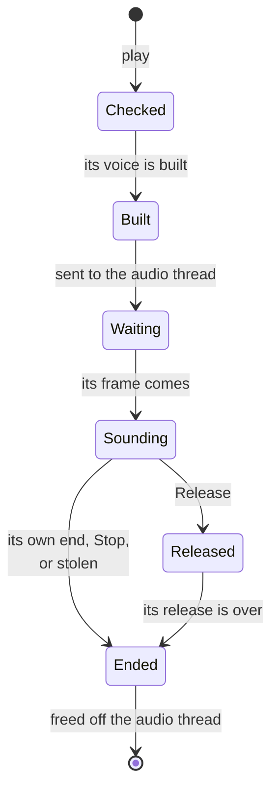

# Events and the life of a note

An event says what to play, and the time it is handed over with says when.
This guide follows a note from the call that hands it over to the moment its voice is freed.

## The events

| [`Event`] | What it does |
| --- | --- |
| `Note` | Starts a note of a synth, by the synth's name, with the options given. |
| `Sample` | Plays a sound file loaded by [`Engine::load_sample`]. |
| `Input` | Plays channels of the sound card's input until stopped. |
| `Set` | Gives options of sounds that already play new values. |
| `Release` | Lets sounds go, as a key let up does. |
| `Stop` | Ends sounds, fading them over 10 ms. |

The first three start a sound.
Each takes an `id`, a number of your choosing that the last three name the sound by, and a `chain`, the effect chain or part it plays into.
[`Event::note`] writes a note with number options and no chain in one line.

## Options are checked before anything plays

A synth declares each option it takes: its kind, its default, its range and a sentence of documentation.
[`Engine::play`] checks every event of a batch against those declarations before it sends any, so a batch with a mistake plays nothing.

- An option the synth does not declare is refused, as is a required one left out, or a name where a number goes.
- A number outside its range is held to the range, and [`Engine::warnings`] says so once for that option.
- An option left out takes its default.
- Every note also takes `amp`, the level it is scaled by, and `pan`, from -1 at the left to 1 at the right.

```rust
use mxs::{Engine, Error, Event, RATE, synths};

fn main() -> Result<(), Error> {
    let mut engine = Engine::offline(RATE);
    synths::all().into_iter().for_each(|s| engine.register(s));

    let wrong = Event::note(None, "marimba", &[("wobble", 1.0)]);
    let refused = Error::UnknownOption {
        owner: "marimba".to_string(),
        option: "wobble".to_string(),
    };
    assert_eq!(engine.play(&[(0.0, wrong)]), Err(refused));

    let too_hard = Event::note(None, "marimba", &[("vel", 3.0)]);
    engine.play(&[(0.0, too_hard)])?;
    let warnings = engine.warnings();
    assert_eq!(warnings, ["marimba's option vel was held to its range, 0 to 1"]);
    Ok(())
}
```

A program can read the declarations itself: [`Synth::specs`] gives a synth's options, and [`Engine::note_specs`] the two every note takes.

## From handed over to freed



- **Checked.** The call that hands the note over checks it, and returns an error or goes on.
- **Built.** The synth's build function makes the voice. A live engine does this on its builder thread, an offline one inside the call.
- **Waiting.** The voice sits with the audio thread until the frame of its time. A note whose time has already passed starts at once, and `warnings` counts it.
- **Sounding.** The voice is filled block by block. Changes reach it at their own samples.
- **Ended.** The engine knows when each note ends from what its synth returned, and takes the voice back then. Every end fades over the voice's last 10 ms, so that a note cut short does not click.

## How a note ends

A synth says how its notes end when it builds one.

- A note that **rings** fades by itself after a number of seconds. A marimba bar or a drum is of this kind.
- A note with an **envelope** is shaped by the options `attack`, `decay`, `sustain` and `release`, and ends when they have run.

`Release` lets a note go before that.
A note with an envelope then falls silent over its `release`, a note that rings goes on until it fades, as a drum does once the hand leaves it, and a sound that never ends, such as live input, fades over 10 ms.
`Stop` ends a sound in 10 ms whatever it is.

A key held for an unknown time is therefore a held note, which sounds until it is let go, with an id, and a `Release` when the key comes up:

```rust
use mxs::{Engine, Event, RATE, synths};

fn main() -> Result<(), mxs::Error> {
    let mut engine = Engine::offline(RATE);
    synths::all().into_iter().for_each(|s| engine.register(s));

    let key_down = Event::held(7, "organ", &[("note", 60.0)]);
    let key_up = Event::Release { ids: vec![7] };
    engine.play(&[(0.0, key_down), (1.5, key_up)])?;

    engine.render(1.0)?;
    assert!(engine.sounding());
    engine.render(2.0)?;
    assert!(!engine.sounding());
    Ok(())
}
```

An id names the last sound started with it.

## Changing a sound while it plays

`Event::Set` gives options new values at a time.
Each option has a partner whose name ends in `_slide`, which makes the change glide over that many seconds.

```rust
use mxs::{Engine, Event, RATE, Target, synths};

fn main() -> Result<(), mxs::Error> {
    let mut engine = Engine::offline(RATE);
    synths::all().into_iter().for_each(|s| engine.register(s));

    let held = Event::note(Some(1), "trombone", &[("note", 50.0), ("sustain", 3.0)]);
    let slur = Event::Set {
        target: Target::Sounds(vec![1]),
        options: vec![("note".to_string(), 55.0), ("note_slide".to_string(), 0.3)],
    };
    let let_go = Event::Release { ids: vec![1] };

    engine.play(&[(0.0, held), (1.0, slur), (2.0, let_go)])?;
    engine.render(3.0)?;
    Ok(())
}
```

A change reaches the options a synth follows while its note sounds.
A change to an option the synth reads only when the note starts does nothing.
On the winds, which are physical models, a change of `note` is a slur.

[`Target`] says what a change applies to.

| Target | What it reaches |
| --- | --- |
| `Sounds(ids)` | The sounds started with these ids. |
| `Part(chain)` | Every sound that plays into a part or an effect chain at that time. |
| `Effect(chain, index)` | One effect of a chain, counted from 0. |

Within one batch the sounds are sent first, so a change can name a note of its own batch.

## The voice limit

An engine plays [`VOICES`] notes at once unless told otherwise.
A note past the limit takes the place of the quietest one sounding, which fades out over 10 ms.
[`Engine::set_voice_limit`] changes the limit, and `warnings` counts the notes stolen.
Live input is not a note and is never stolen.

```rust
use mxs::{Engine, Event, RATE, synths};

fn main() -> Result<(), mxs::Error> {
    let mut engine = Engine::offline(RATE);
    synths::all().into_iter().for_each(|s| engine.register(s));
    engine.set_voice_limit(2);

    let chord = [60.0, 64.0, 67.0].map(|note| (0.0, Event::note(None, "piano", &[("note", note)])));
    engine.play(&chord)?;
    engine.render(0.5)?;
    assert_eq!(engine.warnings(), ["1 note was stolen to keep to 2 at once"]);
    Ok(())
}
```

[The guide to building a synth][building] shows the other side of all this: how a synth declares its options and says how its notes end.

[building]: building.md
