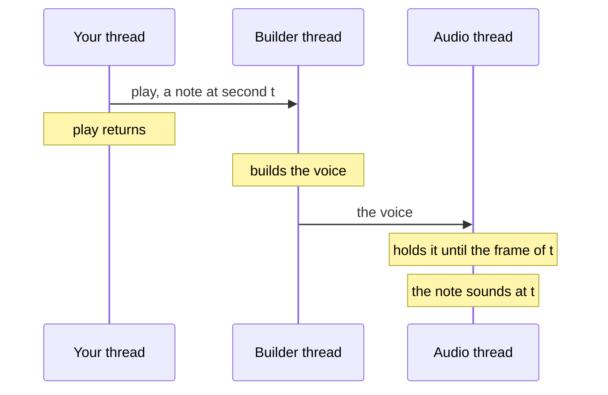

# Playing live

A live engine plays through a sound card, which asks it for one buffer of samples after another and cannot wait for any of them.
This guide covers choosing the device, handing notes over in time, telling whether the engine keeps up, and playing from a MIDI keyboard.

## Choosing the device

[`Engine::live`] plays through the default output device at the device's own rate.
[`Engine::live_with`] takes [`Settings`] that name the device, the rate and the buffer size, and falls back to the device's defaults for what they leave out.
[`devices`] lists the devices there are, each with the rates and the buffer sizes it supports.

```rust,no_run
use mxs::{Engine, Settings, devices};

fn main() -> Result<(), mxs::Error> {
    for device in devices()? {
        let kind = if device.output { "output" } else { "input" };
        println!("{kind}: {}, buffers of {:?} frames", device.name, device.buffers);
    }

    let engine = Engine::live_with(&Settings {
        buffer: Some(128),
        ..Settings::default()
    })?;
    println!("{} Hz, {:?} s from filling a frame to hearing it", engine.rate(), engine.latency());
    Ok(())
}
```

- A device, a rate or a buffer size the sound card cannot take is refused, and the error names what it can take.
- The engine runs at the device's rate, which [`Engine::rate`] gives. It need not be [`RATE`], the rate an offline engine is usually made with.
- A smaller buffer shortens the delay from a note to its sound, and leaves the engine less time to fill each buffer.
- The engine writes 32-bit float samples when the device takes them, and 24-bit or 16-bit ones otherwise.
- An engine started without a named device follows the system's default output: when headphones are plugged in or another output is chosen, its sound moves there after a gap of about 100 ms, and the notes handed over keep their times.
- After such a move, a [`Topic::Output`] report names the new device and its delay, within half a second, and the clock reports line the engine's seconds up with the system clock again.
- The engine keeps its rate through a move, and the system converts it to the new device's rate when the two differ, which [`Engine::warnings`] then says.
- An engine started on a named device stays on it, and calls on it are refused with [`Error::DeviceLost`] once that device goes away.

## How far ahead to hand a note over

Building a note's voice is the costly part of starting it: about 0.2 ms for a piano note or a berimbau stroke and 0.05 ms for a cello note, once the instrument has played a note, and a few milliseconds for its first.
A live engine builds voices on a thread of its own, in the order the notes were handed over.



- [`Engine::play`] returns once the events are checked. Neither the caller nor the audio thread waits for a voice.
- A note therefore has to be handed over before its time by at least what it and the notes handed over ahead of it take to build: about 2 ms for a chord of ten piano notes.
- A note handed over with less time starts as soon as it is built, and [`Engine::warnings`] counts it among the events that arrived after their time.
- A change, a release or a stop handed over after a note reaches it, though the note's voice may not be built yet when the call returns.

A program that knows its notes ahead hands them over a tenth of a second or more before they sound, which stays clear of all this:

```rust,no_run
use mxs::{Engine, Event, synths};
use std::{thread, time::Duration};

fn main() -> Result<(), mxs::Error> {
    let mut engine = Engine::live()?;
    synths::all().into_iter().for_each(|s| engine.register(s));

    let start = engine.now() + 0.1;
    let events: Vec<(f64, Event)> = [60.0, 64.0, 67.0, 72.0]
        .iter()
        .enumerate()
        .map(|(i, &note)| {
            let at = start + 0.5 * i as f64;
            (at, Event::note(None, "marimba", &[("note", note), ("vel", 0.7)]))
        })
        .collect();
    engine.play(&events)?;

    thread::sleep(Duration::from_secs(4));
    Ok(())
}
```

An instrument played by hand cannot hand its notes over ahead.
It gives each note the time [`Engine::now`], and the note sounds as soon as its voice is built.

## Voices kept ready

[`Engine::keep_ready`] keeps a number of voices of an instrument built before any note asks for one, so a note played by hand starts with nothing left to build:

```rust,no_run
use mxs::{Engine, Event, synths};

fn main() -> Result<(), mxs::Error> {
    let mut engine = Engine::live()?;
    synths::all().into_iter().for_each(|s| engine.register(s));
    engine.keep_ready("piano", 10)?;

    let chord: Vec<(f64, Event)> = [60.0, 64.0, 67.0]
        .iter()
        .map(|&note| (engine.now(), Event::note(None, "piano", &[("note", note), ("vel", 0.8)])))
        .collect();
    engine.play(&chord)?;
    Ok(())
}
```

- A note, held or not, that gives no options but `note`, `vel`, `bend`, `brightness`, `pressure` and a `pedal` of 0 or 1 takes a ready voice of its synth, which the audio thread fills with what it was given as the note starts, building and allocating nothing.
- A note handed over at [`Engine::now`] then starts in the next buffer the sound card asks for: a chord of ten piano notes is handed over in under a millisecond, and late by at most one buffer.
- A ready voice sounds as a voice built for the same note, sample for sample.
- Each voice taken is replaced on the builder thread, so the number asked for is kept: ten piano voices are back within about 10 ms.
- A note with any other option, of a synth with no voice ready, or in a pass is built as before.
- The instruments fitted to recordings can be kept ready: the piano, guitar, electric bass, deep bass, harp, electric piano, electric guitar, marimba, vibraphone, xylophone, glockenspiel and timpani, and the violin, cello and `flute_figured`; a voice of any other synth is refused with [`Error::CannotKeepReady`].
- Filling a ready voice takes the audio thread 0.1 to 0.2 ms for a piano note, so a chord of ten takes up to 2 ms of one buffer.
- A held note that slides to another note or vel while it sounds still works out the new note's figures on the audio thread, as a note built for it does.

## Whether the engine keeps up

A live engine has to fill each buffer before the sound card needs it, and a buffer filled too late is heard as a gap.

- [`Engine::load`] gives a [`Load`]: how long filling took as a share of the time the buffers last, the mean and the worst since it was last called, and how many buffers were late and by how much.
- [`Engine::warnings`] says how many buffers were late since it was last called, beside the events that arrived after their time and the notes stolen.
- [`Engine::behind`] says how many seconds the engine's clock has fallen behind the system's since it started, which is the gaps in the sound and the drift between the two clocks.

```rust,no_run
use mxs::Engine;
use std::{thread, time::Duration};

fn main() -> Result<(), mxs::Error> {
    let mut engine = Engine::live()?;
    loop {
        thread::sleep(Duration::from_secs(1));
        let load = engine.load();
        let (mean, worst) = (load.mean * 100.0, load.worst * 100.0);
        println!("filling takes {mean:.0}% of the time, {worst:.0}% at worst; {} late", load.late);
        engine.warnings().iter().for_each(|warning| println!("{warning}"));
    }
}
```

After a gap, the engine's clock is behind for good, and [`Engine::seconds_at`] and [`Engine::play_at`] catch up with it by at most a millisecond a second.
Until they have, an event given a system time plays late by what is left of the gap; `behind` shows the gap within a second.

When the load is too high, the two things to change are the buffer size in [`Settings`] and the voice limit, [`Engine::set_voice_limit`], which [the guide to events][events] describes.

## When the engine stops

- A synth or an effect that panics while the audio thread runs it silences the engine, and every later call returns [`Error::Failed`].
- A device that is unplugged or switched off makes every later call return [`Error::DeviceLost`].

Neither takes the process down.
In both cases the program makes a new engine and registers its synths again.

## A MIDI keyboard

[`keys::Keyboard`] turns MIDI messages into events for one synth.
A key starts a note at its pitch and loudness, letting it up lets the note go, the sustain pedal holds what is sounding, and the pitch bend wheel bends it.

It takes the bytes of each message and the time to play at, and returns the events, so it works with whatever reads the MIDI port.

```rust
use mxs::keys::Keyboard;
use mxs::{Engine, RATE, synths};

fn main() -> Result<(), mxs::Error> {
    let piano = synths::piano();
    let mut keyboard = Keyboard::new(&piano);
    let mut engine = Engine::offline(RATE);
    engine.register(piano);

    let key_down = keyboard.message(&[0x90, 60, 100], 0.0);
    let key_up = keyboard.message(&[0x80, 60, 0], 1.0);
    engine.play(&key_down)?;
    engine.play(&key_up)?;

    engine.render(0.5)?;
    assert!(engine.sounding());
    Ok(())
}
```

The `keys` program in the repository reads a MIDI input with the `midir` crate and plays a synth from it:

```sh
cargo run --release --features keys --bin keys -- --list
cargo run --release --features keys --bin keys -- --synth piano --buffer 128
```

[events]: events.md
