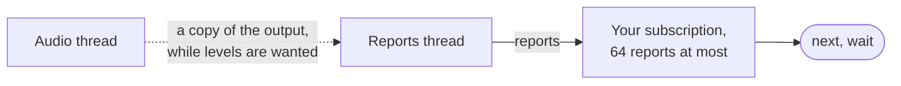

# What the engine reports

An engine says what it is doing to whoever subscribes: where its clock is, how loud its output is, how many notes sound, where the beat is.
A program draws a meter, a scope or a playhead from these, and never has to ask.

[`Engine::subscribe`] takes the kinds of report wanted, each a [`Topic`], and returns the subscription, a [`Reports`].
The engine then sends reports to it, and the program takes them when it likes.

```rust
use mxs::{Engine, Event, RATE, Report, Topic, synths};

fn main() -> Result<(), mxs::Error> {
    let mut engine = Engine::offline(RATE);
    synths::all().into_iter().for_each(|s| engine.register(s));
    let reports = engine.subscribe(&[Topic::Levels]);

    engine.play(&[(0.0, Event::note(None, "piano", &[("note", 48.0)]))])?;
    engine.render(1.0)?;

    let mut loudest: f32 = 0.0;
    let mut count = 0;
    while let Some(report) = reports.next() {
        if let Report::Levels(levels) = report {
            loudest = loudest.max(levels.peak[0]);
            count += 1;
        }
    }
    assert_eq!(count, 20);
    assert!(loudest > 0.01);
    Ok(())
}
```

A live program waits for them on a thread of its own:

```rust,no_run
use mxs::{Engine, Report, Topic};
use std::time::Duration;

fn main() -> Result<(), mxs::Error> {
    let engine = Engine::live()?;
    let reports = engine.subscribe(&[Topic::Levels, Topic::Voices]);
    while let Some(report) = reports.wait(Duration::from_secs(1)) {
        match report {
            Report::Levels(levels) => println!("{:.2} s: peak {:?}", levels.seconds, levels.peak),
            Report::Voices { sounding, .. } => println!("{sounding} notes sound"),
            _ => {}
        }
    }
    Ok(())
}
```

## The kinds of report

Every report carries the engine's seconds of the sample it describes, which [`Report::seconds`] gives.

| Kind | What it holds | When it is sent |
| --- | --- | --- |
| [`Topic::Clock`] | The engine's seconds, the system time at which the sound card plays them, and the output's delay, which that time includes. | At once, whenever the two clocks move apart by more than 2 ms, and at least once a second. An offline engine has no system time and sends none. |
| [`Topic::Levels`] | A [`Levels`]: for the left and the right channel of the main output, the loudest sample and the RMS level, where 1 is full scale; whether a sample reached full scale; the wave as [`WAVE`] points from -1 to 1; the level in dB of [`BANDS`] bands from 50 Hz to 16 kHz, each about a third of an octave, which [`Levels::band`] gives the edges of; and the loudest sample and the RMS level of each part, by its name. | Twenty times a second, each report covering the twentieth of a second before it. The bands cover the last 8192 frames. |
| [`Topic::Voices`] | How many notes sound. | About once a second. |
| [`Topic::Output`] | The device's name, the rate in Hz, and the output's delay in milliseconds. An offline engine has no device and no delay. | At once. The engine keeps its device for as long as it runs, so no second one follows. |
| [`Topic::Warnings`] | One warning, worded as [`Engine::warnings`] words it. | At once for a value held to its range or a note that could not be built, and within a second for the counts of late buffers, late events and stolen notes. |
| [`Topic::Beats`] | A beat, the engine's seconds at which it falls, the tempo from that beat on, and the system time at which the sound card plays it, which a live engine knows. | At once, with the last one sent, then for each change to the tempo map, up to 150 ms before its beat, and every quarter beat while the tempo moves. |
| [`Topic::Passes`] | [`Report::PassStarted`]: the part, the label and the beat of the first event of a pass whose label is another than that of the pass handed to the part before it. [`Report::PassEnding`]: the part and the last beat of its last pass, when that beat is the pass's `notice` in beats away and no other pass was handed to the part. | Once the engine's clock reaches the seconds the report carries. |

[The guide to time][time] shows a program that keeps a part fed from the `Passes` reports.

## What reporting costs



- A kind nobody subscribes to is not worked out, and subscribing changes no sample of the output.
- A live engine works its reports out on a thread of its own. The audio thread only copies its output into a ring buffer while levels are wanted, and never waits.
- An offline engine works them out as it renders, the same reports on every run for the same events and the same calls to `render`.

## Taking reports

- [`Reports::next`] takes the oldest report that waits, and [`Reports::wait`] also waits for one to arrive.
- A subscription holds 64 reports at most. Past that the oldest are dropped, and a [`Report::Dropped`] in their place says how many.
- [`Reports::subscribe`] adds a kind and [`Reports::unsubscribe`] ends one. Dropping the subscription ends all of them.
- [`Engine::warnings`], [`Engine::now`] and [`Engine::clock`] answer whether or not anyone subscribes, and a warning sent as a report is still given by `warnings`.

[time]: time.md
