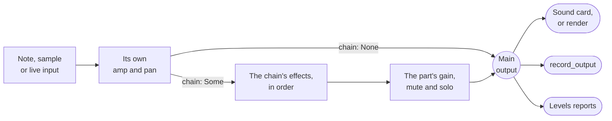
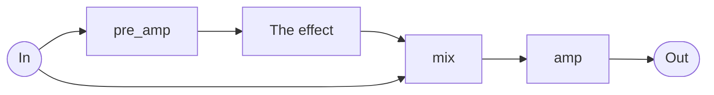

# Effects, parts and the signal path

Every sound goes one of two ways: straight to the main output, or through an effect chain first.
A part is an effect chain with a name, which can be turned down, muted or soloed.



- Every sound is stereo by the time it leaves its voice: a mono synth is placed by `pan`, and a stereo one is balanced by it.
- A sound plays into one chain or into none.
- The chains are added up into the main output with the sounds that play into none.
- What is recorded and what the levels reports measure is the main output, after every gain and mute.

## An effect chain

[`Engine::start_effects`] makes a chain from effects by name, each with its options, in order.
It returns the number a note names as its `chain`.

```rust
use mxs::{Engine, Event, RATE, Value, effects, synths};

fn main() -> Result<(), mxs::Error> {
    let mut engine = Engine::offline(RATE);
    synths::all().into_iter().for_each(|s| engine.register(s));
    effects::all().into_iter().for_each(|e| engine.register_effect(e));

    let echo = ("echo".to_string(), vec![("phase".to_string(), Value::Number(0.25))]);
    let reverb = ("reverb".to_string(), vec![("room".to_string(), Value::Number(0.6))]);
    let chain = engine.start_effects(&[echo, reverb])?;

    let note = Event::Note {
        id: None,
        synth: "vibraphone".to_string(),
        options: vec![("note".to_string(), Value::Number(67.0))],
        chain: Some(chain),
    };
    engine.play(&[(0.0, note)])?;
    engine.render(3.0)?;
    Ok(())
}
```

Each effect of a chain blends what it makes with what came in.



- `pre_amp` scales the sound before the effect.
- `mix` says how much of the processed sound replaces the dry one, from 0 to 1.
- `amp` scales the blend.

Every effect takes these three besides its own options.
[The `effects` module](crate::effects) lists the effects that come with the crate and the options of each.

### Changing an effect while it runs

An `Event::Set` aimed at [`Target::Effect`] changes one effect of a chain, by its place in the chain counted from 0.
Here a low-pass filter closes over two seconds under a held chord.

```rust
use mxs::{Engine, Event, RATE, Target, Value, effects, synths};

fn main() -> Result<(), mxs::Error> {
    let mut engine = Engine::offline(RATE);
    synths::all().into_iter().for_each(|s| engine.register(s));
    effects::all().into_iter().for_each(|e| engine.register_effect(e));

    let filter = ("lpf".to_string(), vec![("cutoff".to_string(), Value::Number(120.0))]);
    let chain = engine.start_effects(&[filter])?;

    let chord = [48.0, 55.0, 64.0].map(|note| {
        let note = Event::Note {
            id: None,
            synth: "saw".to_string(),
            options: vec![
                ("note".to_string(), Value::Number(note)),
                ("sustain".to_string(), Value::Number(3.0)),
            ],
            chain: Some(chain),
        };
        (0.0, note)
    });
    engine.play(&chord)?;

    let close = Event::Set {
        target: Target::Effect(chain, 0),
        options: vec![("cutoff".to_string(), 50.0), ("cutoff_slide".to_string(), 2.0)],
    };
    engine.play(&[(0.5, close)])?;
    engine.render(3.0)?;
    Ok(())
}
```

### When a chain ends

[`Engine::stop_effects`] removes a chain from a time on.
The chain stays until its sounds have ended and its effects' tails have rung out, so a reverb is not cut off.
Each effect declares how long its tail is.

## Parts

A part is a chain started under a name by [`Engine::start_part`], with effects or with none.
Its gain, its mute and its solo apply after its effects, so a reverb's tail is turned down with its part.

```rust
use mxs::{Engine, Event, RATE, Value, synths};

fn main() -> Result<(), mxs::Error> {
    let mut engine = Engine::offline(RATE);
    synths::all().into_iter().for_each(|s| engine.register(s));

    let bass = engine.start_part("bass", &[])?;
    let note = Event::Note {
        id: None,
        synth: "piano".to_string(),
        options: vec![
            ("note".to_string(), Value::Number(36.0)),
            ("sustain".to_string(), Value::Number(3.0)),
        ],
        chain: Some(bass),
    };
    engine.play(&[(0.0, note)])?;
    engine.mute("bass", true, 1.0)?;
    engine.mute("bass", false, 2.0)?;

    let (heard, _) = engine.render(1.0)?;
    let (muted, _) = engine.render(1.0)?;
    let (heard_again, _) = engine.render(1.0)?;
    let silent = |samples: &[f32]| samples.iter().all(|sample| *sample == 0.0);
    assert!(!silent(&heard));
    assert!(silent(&muted[RATE as usize / 2..]));
    assert!(!silent(&heard_again));
    Ok(())
}
```

- [`Engine::set_gain`], [`Engine::mute`] and [`Engine::solo`] take the part's name and a time in seconds, and reach their level over 10 ms from that time, so nothing clicks.
- A muted part plays on unheard. A note that started while the part was muted is heard from where it has got to once the part is unmuted.
- While any part is soloed, only the soloed parts are heard. A part both muted and soloed is silent. A sound that plays into no part is heard as ever.
- [`Engine::part`] gives the number to play into a part by its name, later.
- [`Engine::stop_part`] removes a part as `stop_effects` removes a chain, and frees its name at once.
- A name no part was started under is refused, and the error names it.
- A levels report gives each part's level after its gain, by its name, as [the guide to reports][reports] describes.

A part is also what events in beats are handed to, a pass at a time.
[The guide to time][time] covers that.

[reports]: reports.md
[time]: time.md
