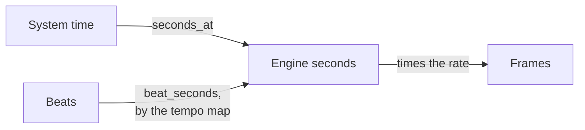
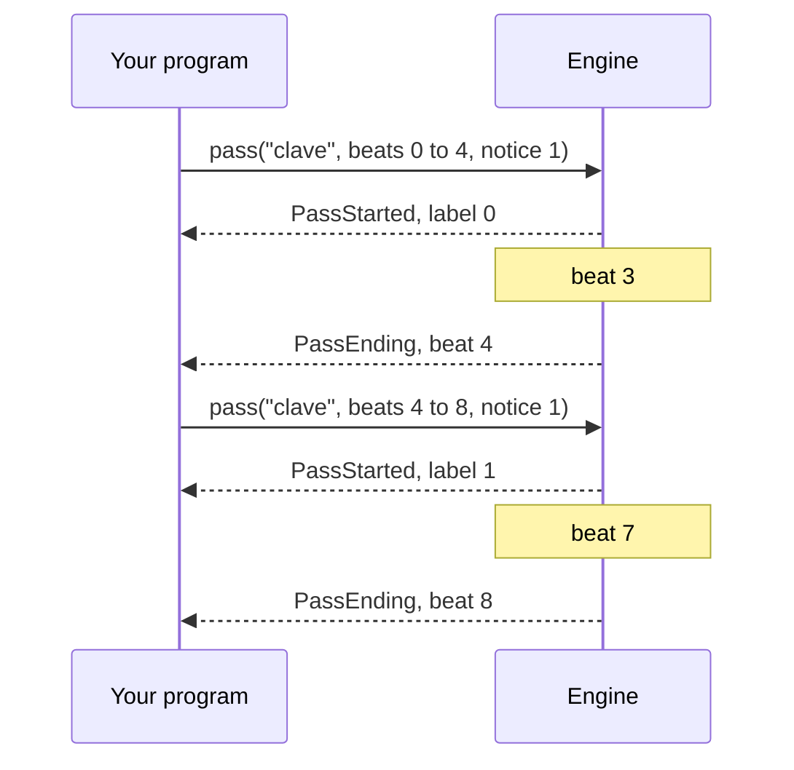

# Frames, seconds and beats

An event can be given its time in four ways: as a frame, as seconds on the engine's clock, as a time of the system's clock, or as a beat.
The engine turns all of them into a frame, and starts the event at that frame exactly.



| The time is | Hand the events over with | Works on |
| --- | --- | --- |
| A frame | [`Engine::play_at_frames`] | Any engine |
| Seconds on the engine's clock | [`Engine::play`] | Any engine |
| A system time | [`Engine::play_at`] | A live engine |
| A beat | [`Engine::pass`] | Any engine |

The four can be mixed: events at seconds play beside events in beats, wherever the tempo map is.

## The engine's clock

The engine's clock counts the frames it has filled.
[`Engine::now`] gives it in seconds, and it starts at 0 when the engine is made.

A live engine's clock is the sound card's, and a sound card does not run at exactly the speed of the system's clock.
The engine reads both at every buffer and keeps track of how they line up.

- [`Engine::clock`] gives the engine's seconds now and the system time at which it fills them.
- [`Engine::seconds_at`] turns a system time into the engine's seconds, however far the two clocks have drifted apart.
- [`Engine::latency`] gives the seconds from filling a frame to the device playing it, when the device says.
- [`Engine::behind`] says how far the engine's clock has fallen behind the system's since it started.

A program that takes its times from elsewhere, such as a network or another clock, uses `play_at` and leaves the drift to the engine.
An offline engine has no system time: `clock` gives none, and `play_at` returns [`Error::Offline`].

Events are handed over ahead of their time, so that the engine can build each voice before it is due.
[The guide to playing live][live] says how far ahead.

## The tempo map

The engine keeps a tempo map, which says at which of its seconds each beat falls.
With it a caller hands events over in beats, bars ahead, and can still change the tempo after.

- [`Engine::place_beats`] places beat 0 at one of the engine's seconds. It is at second 0 until placed.
- [`Engine::set_tempo`] changes the tempo from a beat on, and replaces whatever the map held from that beat on.
- [`Tempo::Hold`] holds a tempo in beats a minute. [`Tempo::Move`] moves evenly from one tempo to another over a number of beats, then holds the second.
- The tempo is 120 beats a minute until changed.

```rust
use mxs::{Engine, RATE, Tempo};

fn main() -> Result<(), mxs::Error> {
    let mut engine = Engine::offline(RATE);
    assert_eq!(engine.beat_seconds(4.0), 2.0);

    engine.set_tempo(4.0, Tempo::Hold(60.0))?;
    assert_eq!(engine.beat_seconds(6.0), 4.0);
    assert_eq!(engine.beat_at(4.0), 6.0);

    engine.place_beats(10.0)?;
    assert_eq!(engine.beat_seconds(0.0), 10.0);
    Ok(())
}
```

[`Engine::beat`] gives the beat of the frame the engine fills next, [`Engine::beat_at`] the beat at one of its seconds, and [`Engine::beat_seconds`] the seconds at which a beat falls.
Beats are floating point numbers, so a third of a beat is approximate.
Each event is placed from its own beat, never by adding lengths up, so the error does not grow along a piece.

## Passes

Events in beats are handed to a part, a pass at a time.
A [`Pass`] is a stretch of a part's music: the beat it starts at, the beat it ends at, a label of the caller's choosing, and the events, each at its beat.

```rust
use mxs::{Engine, Event, Pass, RATE, Tempo, synths};

fn main() -> Result<(), mxs::Error> {
    let mut engine = Engine::offline(RATE);
    synths::all().into_iter().for_each(|s| engine.register(s));
    engine.start_part("lead", &[])?;

    engine.set_tempo(0.0, Tempo::Hold(96.0))?;
    let notes = [60.0, 64.0, 67.0, 72.0];
    let events = notes.iter().enumerate().map(|(beat, note)| {
        let options = [("note", *note), ("sustain", 0.5), ("release", 0.5)];
        (beat as f64, Event::note(None, "piano", &options))
    });
    let pass = Pass {
        from: 0.0,
        to: 4.0,
        label: 1,
        notice: Some(1.0),
        events: events.collect(),
    };
    engine.pass("lead", &pass)?;
    engine.set_tempo(2.0, Tempo::Move { from: 96.0, to: 60.0, over: 2.0 })?;
    engine.cut("lead", 3.0)?;
    engine.render(4.0)?;
    Ok(())
}
```

The engine keeps the events of a pass at their beats, and gives each its frame only 150 ms before it sounds.
That is what lets the tempo change under music already handed over.

- A change to the tempo map moves every event that is more than 150 ms from sounding to where its beat now falls. The nearer ones stay where they were.
- In a pass, an option that a synth or an effect declares in beats is given in beats, and so is every `_slide`. Each lasts as long as those beats last at the tempo of the event's beat. In `play` the same options are in seconds.
- [`Engine::cut`] drops every event of a part at or after a beat that has not started, so that another pass can be handed over in its place. A note that started before the cut rings on, and a release dropped with the rest no longer ends it.
- An event handed over after its beat plays at once when it is less than a quarter of a beat late, and is dropped otherwise. [`Engine::warnings`] counts both. A release or a stop is never dropped, so no note is left ringing.
- The `chain` an event of a pass names is left aside: the event plays into the pass's part.

### Keeping a part fed

A program that plays for as long as it runs hands each part one pass after another.
The engine tells it when to: a pass's `notice` asks for a report that many beats before the pass ends, unless another pass was handed over by then.



The reports come to a subscription to [`Topic::Passes`].
`PassStarted` is sent when the first event of a pass sounds, if the pass's label is another than that of the pass before it, so a program can show which pass is heard.

```rust
use mxs::{Engine, Event, Pass, RATE, Report, Topic, synths};

fn bar(from: f64) -> Pass {
    let strokes = (0..4).map(|stroke| (from + stroke as f64, Event::note(None, "clave", &[])));
    Pass {
        from,
        to: from + 4.0,
        label: (from / 4.0) as u64,
        notice: Some(1.0),
        events: strokes.collect(),
    }
}

fn main() -> Result<(), mxs::Error> {
    let mut engine = Engine::offline(RATE);
    synths::all().into_iter().for_each(|s| engine.register(s));
    engine.start_part("clave", &[])?;
    let reports = engine.subscribe(&[Topic::Passes]);

    engine.pass("clave", &bar(0.0))?;
    let mut heard = Vec::new();
    while engine.now() < 5.0 {
        engine.render(0.05)?;
        while let Some(report) = reports.next() {
            match report {
                Report::PassEnding { beat, .. } => engine.pass("clave", &bar(beat))?,
                Report::PassStarted { label, .. } => heard.push(label),
                _ => {}
            }
        }
    }
    assert_eq!(heard, [0, 1, 2]);
    Ok(())
}
```

A live program does the same with [`Reports::wait`] on a thread of its own, and no call to `render`.

### Effects that follow the tempo

[`Engine::start_part_in_beats`] starts a part whose effects take their options in beats.
Those an effect lets change while it runs, such as the time between an echo's repeats, follow the tempo as it changes.
They are read again at each change of tempo, and every quarter beat while the tempo moves.
An option set in seconds through `play` stops following.

### Where the beat is

A subscription to [`Topic::Beats`] is sent a [`Report::Beat`] at once, then one for each change to the tempo map, up to 150 ms before its beat.
Each gives a beat, the engine's seconds at which it falls, the tempo from that beat on, and on a live engine the system time at which the sound card plays it.
The last one received says where every later beat falls, until the next.

## Under the tempo map

[`Engine::fill`] is the layer under the tempo map, for a caller that keeps time itself.
It fills one block after another of an offline engine from events given at frames or at seconds, and needs neither the map nor a sound card.
It does not place events in beats; [`Engine::render`] does.

```rust
use mxs::{Engine, Event, RATE, synths};

fn main() -> Result<(), mxs::Error> {
    let mut engine = Engine::offline(RATE);
    synths::all().into_iter().for_each(|s| engine.register(s));
    engine.play_at_frames(&[(256, Event::note(None, "kick", &[]))])?;

    let (mut left, mut right) = ([0.0; 512], [0.0; 512]);
    engine.fill(&mut left, &mut right)?;
    assert!(left[..256].iter().all(|sample| *sample == 0.0));
    assert!(left[256..].iter().any(|sample| *sample != 0.0));
    Ok(())
}
```

Reading song files, patterns and loops stays with the caller.

[live]: live.md
